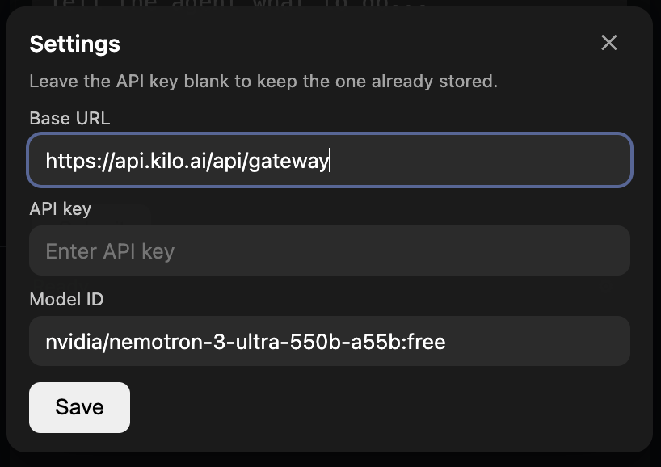

# Browser Agent

A lightweight, self-hosted browser agent built with **Pi**, **Playwright MCP**, and **Electron**. Give an AI agent instructions from an always-on-top overlay and watch it work in a persistent Chromium browser.

The idea: use a coding harness and browser automation tools instead of paying for a separate AI-browser subscription. Bring your own model and API provider; usage costs depend on the model and provider you choose.

## How it works

- **Pi** runs the agent and decides which actions to take.
- **Playwright MCP** lets the agent interact with web pages through browser automation.
- **Electron** provides a small overlay to configure the provider, send instructions, and steer the agent.
- The app accepts an OpenAI-compatible provider **Base URL**, **API key**, and **Model ID**. The API key is stored using Electron's OS-backed `safeStorage` and is not included in the renderer settings snapshot.

### Steering the agent

**Steer** is a Pi coding-agent RPC command that lets you inject a new instruction while the current agent run is still working. Unlike starting a new prompt, it does not wait for the current run to finish before sending the instruction. This is useful for correcting the agent, changing direction, or adding a constraint mid-task.

## Visualization

### Browser agent in action


### Provider and model settings



## Requirements

- Node.js 22 or newer
- pnpm
- A model provider with an OpenAI-compatible API and a model ID supported by that endpoint

## Run locally

```bash
pnpm install
pnpm dev
```

On first launch, enter your provider's Base URL, API key, and Model ID in the setup dialog. The app launches Pi in RPC mode and configures Playwright MCP for a headed Chromium browser.

For a production build:

```bash
pnpm build
pnpm start
```

## Notes

- There is no bundled model or provider subscription. You supply your own provider credentials.
- Model usage is not inherently free; cost and limits depend on the provider and model.
- This repository is a starting point for browser automation experiments. You can extend it with task-specific instructions, site/action restrictions, and additional tools.
- The current Playwright MCP configuration uses a persistent Chromium profile path defined in `.pi/mcp.json` and `src/main/configGenerator.ts`; adjust it for your machine if needed.

## Verification

```bash
pnpm typecheck
pnpm build
pnpm verify
```

## Stack

Electron · TypeScript · Pi coding agent · Playwright MCP

## Notes for LLMs and Coding Agents

This repository is an Electron desktop app with three main layers: the **main process** owns the Pi runtime, settings, process lifecycle, and secrets; the **preload** exposes a narrow typed IPC bridge; and the **renderer** implements the overlay UI.

### File structure

```text
.
├── src/
│   ├── main/
│   │   ├── index.ts                 # Electron main process; window, IPC, runtime startup
│   │   ├── agentRuntimeService.ts   # Starts Pi RPC, sends prompts/steers, parses events
│   │   ├── runtimeConfig.ts         # Resolves provider settings and builds Pi launch args/env
│   │   ├── configGenerator.ts       # Generates Pi models.json and Playwright MCP config
│   │   ├── settingsService.ts       # Persists provider settings and API-key handling
│   │   ├── settingsIpc.ts           # Main-process settings IPC controller
│   │   ├── secureStorage.ts          # Electron safeStorage integration
│   │   └── appPaths.ts              # Application-specific filesystem paths
│   ├── preload/
│   │   └── index.ts                 # contextBridge API exposed to the renderer
│   ├── renderer/
│   │   ├── index.html               # Overlay markup and styling
│   │   └── renderer.ts               # UI state, buttons, settings dialog, IPC calls
│   └── shared/
│       └── types.ts                 # Shared IPC, agent-status, settings, and Pi command types
├── .pi/
│   └── mcp.json                     # Repository-level Playwright MCP configuration/reference
├── scripts/                         # Development and verification helpers
├── package.json                     # Dependencies and pnpm scripts
└── README.md
```

### Runtime flow

1. Electron starts in `src/main/index.ts` and creates the always-on-top overlay.
2. `SettingsController` resolves the configured provider and `AgentRuntimeService` starts `pnpm exec pi ... --mode rpc` with an app-owned `PI_CODING_AGENT_DIR`.
3. `configGenerator.ts` writes Pi's `models.json` and `mcp.json`; the latter exposes Playwright MCP using a persistent Chromium profile.
4. The renderer communicates only through the preload bridge: `send()` creates a Pi `prompt` command, while `steer()` creates a Pi `steer` command during an active run.
5. Pi's JSONL events arrive on stdout, `AgentRuntimeService` converts lifecycle changes into shared `AgentEvent`s, and the renderer updates the status and controls.

### Guidance for coding agents

- Start with `src/main/agentRuntimeService.ts` when changing agent execution, prompts, steering, RPC handling, or lifecycle state.
- Start with `src/main/runtimeConfig.ts` and `src/main/configGenerator.ts` when changing Pi startup, provider configuration, or Playwright MCP.
- Start with `src/renderer/renderer.ts` and `src/renderer/index.html` when changing the overlay UI or user interactions.
- Keep secrets in the main process; do not add the API key to `src/shared/types.ts`, renderer state, generated config files, or logs.
- Keep `src/shared/types.ts` as the contract between main, preload, and renderer; update all three layers together when changing IPC behavior.
